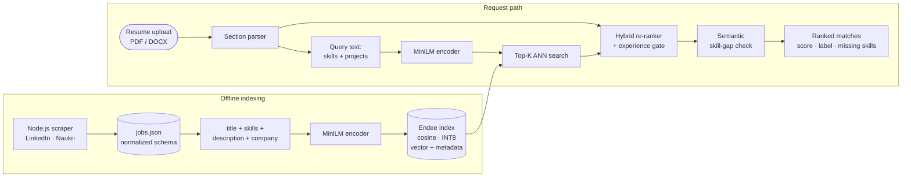

<div align="center">

# 🎯 AI Job Recommender

**Upload a resume and get ranked job matches with a clear skill-gap report, scored by a hybrid of semantic similarity and explicit skill overlap.**


<br/>


[How it works](#how-it-works) · [Scoring](#the-scoring-model) · [Design decisions](#design-decisions) · [Quick start](#quick-start)

</div>

---

## Overview

Keyword-based job boards miss obvious matches ("PyTorch" vs "deep learning frameworks") and give no explanation for a match. This project treats job matching as a **retrieval and ranking problem**:

1. **Parse** the resume (PDF or DOCX) into sections: skills, projects, experience, education.
2. **Retrieve** candidate jobs by dense vector similarity from a vector database.
3. **Re-rank** them with a transparent hybrid score that combines semantic fit with explicit skill coverage, and filter out jobs that need more experience than the candidate has.
4. **Explain** each match: a match label, a percentage score and the skills that are **actually** missing. A missing skill is checked semantically, so "ML" is not reported as missing when the resume says "machine learning".

### Highlights

| | |
|---|---|
| **Retrieval** | `all-MiniLM-L6-v2` (384-d) embeddings → Endee cosine index with **INT8 quantization** |
| **Ranking** | `0.6 × semantic similarity + 0.4 × skill coverage`, with an experience gate and a relevance threshold |
| **Skill-gap analysis** | Embedding-based: a job skill counts as missing only if no resume skill reaches cosine ≥ 0.82 |
| **Parsing** | Line-based section detection that works across resume templates; DOCX is converted to PDF with headless LibreOffice, cached by content hash |
| **Vector DB evaluation** | v1 used FAISS, with search latency measured before migrating to Endee |
| **Data** | Job listings collected by a separate Node.js scraper (LinkedIn and Naukri) and normalized into one schema |
| **Instrumentation** | Per-stage latency logging for parsing, search, rendering and the full pipeline |

---

## How it works



### 1. Resume parsing (`resume_parser.py`)

- **PDF:** pdfplumber extracts text line by line. A line counts as a section heading if it contains a known section keyword, has 4 words or fewer and doesn't end with a period. Each following line is assigned to the current section.
- **DOCX:** converted to PDF with **headless LibreOffice**, so there is only one parsing path to maintain. Conversions are cached under an **MD5 content hash**, so re-uploading the same file costs nothing.
- Years of experience are extracted from the full text with a regex such as `3+ years`.

### 2. Retrieval (`vectorize.py`)

- Each job is embedded as one structured document (`Title / Skills / Description / Company`), and the job's metadata is stored **with the vector** in Endee. A search hit carries everything the UI needs, with no second lookup.
- The resume query is built from **skills and projects only**. Contact details, education boilerplate and long summaries add noise to the embedding without making it more discriminative.
- The embedding model is **lazy-loaded once per process** and reused across requests.

### 3. Ranking and explanation

Covered in detail below.

---

## The scoring model

For each retrieved job:

```text
semantic      = cosine(resume_query_vector, job_vector)                 # from the vector DB
skill_cover   = |resume_skills ∩ job_skills| / |job_skills|             # explicit requirement coverage
final_score   = 0.6 · semantic + 0.4 · skill_cover

drop the job if   candidate_years < job.min_experience                  # hard constraint, not a soft penalty
keep the job if   final_score > 0.33
label             > 0.65 → Strong Match · > 0.45 → Good Match · otherwise Moderate Match
```

**Semantic missing skills:** for each job skill the candidate doesn't list exactly, the closest resume skill is found by embedding similarity. The job skill is reported as missing **only if that best similarity is below 0.82**. This removes false gaps from synonyms, abbreviations and casing differences (`Postgres` / `PostgreSQL`, `ML` / `machine learning`), which a plain set difference would report.

**Why hybrid?** Dense similarity alone over-rewards jobs that are *topically* close (a "Data Engineer" posting for an ML resume). Skill coverage alone is brittle to wording. Combining the two keeps the semantic recall and anchors the ranking to the job's stated requirements, and each component stays easy to explain to the user.

---

## Design decisions

| Decision | Reasoning |
|---|---|
| **Endee over the original FAISS index** | v1 used an in-process FAISS `IndexFlatL2`, which kept vectors only in memory and required a separate ID → metadata mapping. Endee runs as its own service with persistent storage, stores metadata with each vector, and supports **INT8 quantization** (about 4× smaller vectors than float32). My notes from the FAISS evaluation are on [Medium](https://medium.com/@ananthashayan2802/vector-database-faiss-for-recommendation-systems-my-key-insights-218c87ed8f53). |
| **Cosine space instead of L2** | MiniLM embeddings are compared by angle. With cosine, "higher = more relevant" holds throughout the pipeline, so thresholds and labels work the same way. |
| **Graceful degradation** | If the vector DB is unreachable, search falls back to an in-process NumPy cosine search over the same embeddings, so the app keeps answering, only more slowly. |
| **Line-based parser over layout or OCR parsing** | Earlier versions used font-height heading detection and OCR for image resumes. Both broke across templates, and OCR quality was too low to trust, so I replaced them with a simpler text rule that turned out to be more robust. Scanned resumes are explicitly out of scope. |
| **Experience as a hard filter** | Recommending a job that requires 5+ years to a fresher is worse than recommending nothing, so experience filters rather than penalizes. |
| **LLM explanations behind a gate** | `explaination.py` can generate Gemini-based improvement advice, limited to the top 2 matches to cap cost. It is currently disabled to keep the end-to-end latency low; the deterministic skill-gap report already covers the main need. |

---

## Tech stack

| Layer | Technology |
|---|---|
| **Web app** | Flask 3, Jinja2 templates, Tailwind CSS |
| **Embeddings** | Sentence Transformers `all-MiniLM-L6-v2` |
| **Vector search** | Endee (cosine, INT8); FAISS (benchmarked in v1); NumPy fallback |
| **Document parsing** | pdfplumber, PyMuPDF, LibreOffice (headless DOCX → PDF) |
| **Data collection** | Node.js, Express, Axios, Cheerio, `linkedin-jobs-api` |
| **LLM (optional)** | Google Gemini |
| **Infrastructure** | Docker, Docker Compose |

---

## Quick start

### With Docker Compose

```bash
git clone https://github.com/Anantha-Shayan/Job-Recommender.git
cd Job-Recommender

docker compose up --build -d                                   # starts the Endee server and the Flask app
docker compose exec backend python job_indexing.py              # embed jobs.json and upsert it into Endee
```

Open **http://localhost:5000** and upload a resume (PDF or DOCX).

### Local development

```bash
docker run -d --name endee -p 8080:8080 -v endee_data:/data endeeio/endee-server:latest

cd backend
python -m venv .venv && source .venv/bin/activate
pip install -r requirements.txt
python job_indexing.py                                          # one-time indexing
python app.py                                                   # http://localhost:5000
```

| Variable | Default | Purpose |
|---|---|---|
| `ENDEE_URL` | `http://127.0.0.1:8080` | Endee server base URL |
| `GOOGLE_API_KEY` | none | Only needed if LLM explanations are turned on |

> DOCX uploads need `soffice` (LibreOffice) on your `PATH`; the Docker image already includes it.

### Refreshing job data (optional)

```bash
cd tech_job_listing
npm install && npm start          # Express API that scrapes and normalizes tech roles
```

---

## Project structure

```text
Job-Recommender/
├── backend/
│   ├── app.py               # Flask routes: upload → parse → search → render, with per-stage latency logs
│   ├── resume_parser.py     # PDF line-based section parser; DOCX → PDF via LibreOffice (hash-cached)
│   ├── vectorize.py         # embedding, Endee indexing and search, hybrid re-ranking, skill-gap analysis
│   ├── job_indexing.py      # one-off: embed jobs.json and upsert it into Endee
│   ├── explaination.py      # optional Gemini explanation generator (gated)
│   ├── jobs.json            # normalized job listings
│   ├── templates/           # home.html (upload), job.html (ranked results)
│   └── Dockerfile
├── tech_job_listing/        # Node.js scraper and normalizer for LinkedIn and Naukri tech roles
└── docker-compose.yml       # Endee + backend
```

---

## Limitations and roadmap

**Current limitations:**
- The job dataset is a small, curated sample (20 listings), meant to demonstrate the pipeline rather than serve as a production catalog.
- Section detection is rule-based, and scanned or image-only resumes are not supported.
- Scoring weights (0.6 / 0.4) and thresholds (0.33, 0.82) were tuned by hand on sample resumes, not learned.

**Next steps:**
- [ ] Build a labeled resume ↔ job relevance set and report precision@k and nDCG to tune the weights.
- [ ] Hybrid retrieval: BM25 + dense, with reciprocal rank fusion.
- [ ] NER- or LLM-based skill extraction with a canonical skill taxonomy.
- [ ] Scheduled scraping → incremental upserts instead of a static `jobs.json`.
- [ ] Return JSON from a REST endpoint alongside the HTML view; add a test suite.

---

<div align="center">

Built by **[Anantha Shayan](https://github.com/Anantha-Shayan)** · [Portfolio](https://ananthadev.online) · [LinkedIn](https://www.linkedin.com/in/anantha-shayan28022006/) · [Medium](https://medium.com/@ananthashayan2802)

</div>
